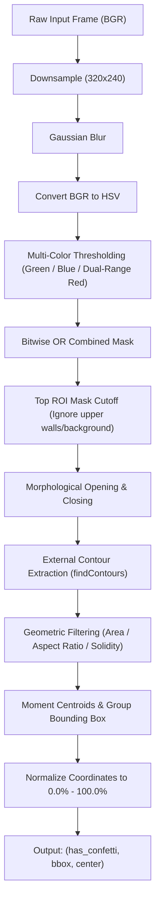
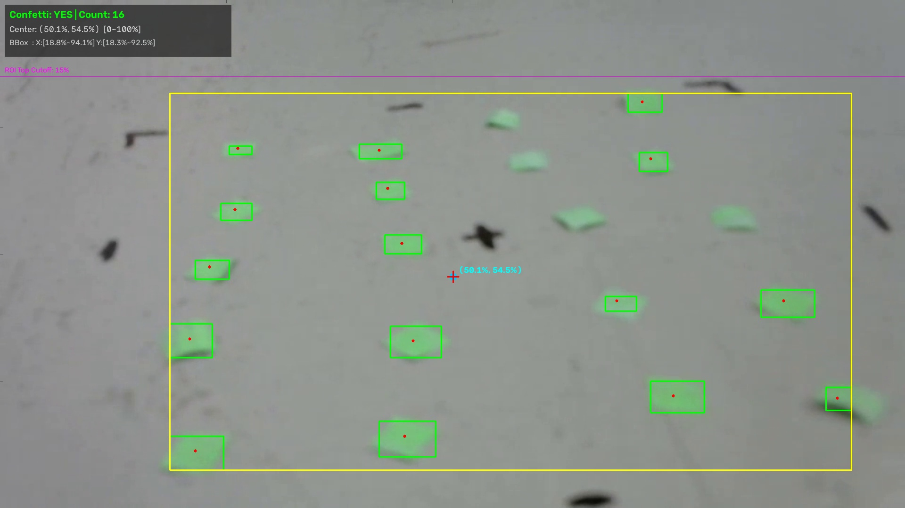

# OpenCV Lightweight Confetti Recognition Module (`frame_recognize/`)

> Language: **English** | [繁體中文](README.zh.md)

A lightweight **ground confetti detection module** designed for embedded edge devices such as **Raspberry Pi 4B**. Using multi-color HSV segmentation and geometric contour filtering, it runs at 30+ FPS with low CPU overhead and normalizes all output coordinates to **0.0% – 100.0%** percentages, decoupling downstream motion control from camera hardware resolution.

---

## 1. Processing Pipeline



---

## 2. Output Specification

`detector.detect(frame)` accepts a single BGR frame and returns a 3-tuple `(has_confetti, bbox, center)`:

| Output | Type | Description |
| :--- | :--- | :--- |
| **`has_confetti`** | `bool` | `True` if valid confetti is detected, `False` otherwise |
| **`bbox`** | `ConfettiBBox \| None` | Combined group bounding box in **0.0% – 100.0%** (`x_min`, `y_min`, `x_max`, `y_max`, `width`, `height`), or `None` |
| **`center`** | `ConfettiCenter \| None` | Area-weighted centroid in **0.0% – 100.0%** (`x`: left-to-right, `y`: top-to-bottom), or `None` |

### Key Algorithmic Stages
1. **Downsampling**: Resizes frames to `320 x 240` (~96% fewer pixels than 1080p) while computing exact percentage coordinates relative to the processing grid.
2. **HSV Color Ranges**:
   - **Green**: $H \in [35, 85], S \in [65, 255], V \in [70, 255]$
   - **Blue**: $H \in [95, 130], S \in [65, 255], V \in [80, 255]$
   - **Red (wrap-around)**: $H \in [0, 10] \cup [170, 179], S \in [85, 255], V \in [80, 255]$
3. **Top ROI Cutoff (`roi_top_ratio=0.15`)**: Zeroes out the top 15% of the mask to ignore distant walls and overhead reflections.
4. **Morphological Filtering**: $3 \times 3$ opening removes isolated pixel noise; 2 iterations of closing fill specular holes.
5. **Geometric Filtering**: Retains contours satisfying $20 \le \text{Area} \le 3500$, $0.25 \le \text{Aspect Ratio} \le 4.0$, and $\text{Solidity} \ge 0.65$.



---

## 3. API Reference (`confetti_detector.py`)

### Basic Usage
```python
import cv2
from confetti_detector import ConfettiDetector

detector = ConfettiDetector()
frame = cv2.imread("test_frame.jpg")

has_confetti, bbox, center = detector.detect(frame)
if has_confetti:
    print(f"Center: X={center.x}%, Y={center.y}%")
    print(f"BBox: {bbox.x_min}%..{bbox.x_max}% x {bbox.y_min}%..{bbox.y_max}%")
```

### Annotated Frame & Custom Parameters
```python
has_confetti, bbox, center, vis_frame = detector.detect(frame, return_annotated=True)
result = detector.process(frame, visualize=True)  # DetectionResult(count, annotated_frame, items)

detector = ConfettiDetector(
    proc_width=320,
    proc_height=240,
    roi_top_ratio=0.15,
    min_area=20,
    max_area=3500,
    min_aspect_ratio=0.25,
    max_aspect_ratio=4.0,
    min_solidity=0.65,
)
```

---

## 4. Test Runner (`detect_confetti_video.py`)

```bash
# Video file test
../venv/bin/python detect_confetti_video.py --source test_video.mp4

# Live webcam test
../venv/bin/python detect_confetti_video.py --source 0

# Save annotated video
../venv/bin/python detect_confetti_video.py --source test_video.mp4 --output test_video_detect.mp4

# Headless / SSH mode (no GUI window)
../venv/bin/python detect_confetti_video.py --source 0 --no-preview
```

### CLI Options & Hotkeys
* Options: `--source/-s` (`test_video.mp4`), `--output/-o` (`None`), `--no-preview`, `--proc-width` (`320`), `--proc-height` (`240`), `--roi-top` (`0.15`), `--max-frames` (`-1`).
* Preview Window Hotkeys: `Q` / `ESC` to quit, `SPACE` to pause/resume, `S` to save screenshot.

---

## 5. Directory Structure

```text
frame_recognize/
├── confetti_detector.py      # Core detector class & normalized BBox/Center dataclasses
├── detect_confetti_video.py  # Video & live camera test runner
├── test_video.mp4            # Sample input video
├── test_video_detect.mp4     # Sample annotated output video
├── README.md                 # English documentation (this file)
├── README.zh.md              # Traditional Chinese documentation
└── docs/images/              # Visualization & diagram assets
```
