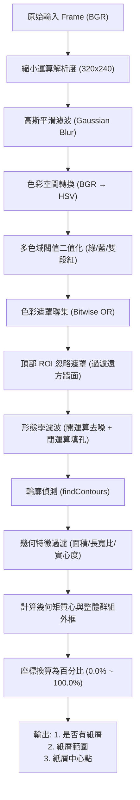
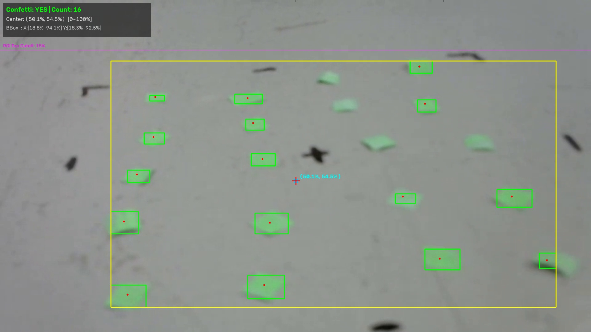

# OpenCV 輕量影像偵測模組 (Confetti Recognition Module)

> 語言：**繁體中文** | [English](README.md)

本模組為機電整合自走車與地面清潔機器人專屬設計之**輕量化地面紙屑辨識系統**。採用色彩空間分割與幾何特徵過濾演算法，專為運算資源有限的嵌入式邊緣設備（例如 **Raspberry Pi 4B**）最佳化，能在低 CPU 佔用率下維持 30+ FPS 即時辨識。

系統將輸出座標全面**歸一化為 0.0% ~ 100.0% 百分比制**，使下游運動控制演算法（如自走車轉向追蹤、清掃吸塵控制）完全與相機鏡頭硬體解析度（720p / 1080p / 4K）解耦。

---

## 目錄

- [系統架構與流程圖](#系統架構與流程圖)
- [核心模組輸出規格](#核心模組輸出規格)
- [影像偵測原理](#影像偵測原理)
  - [1. 影像降採樣 (Downsampling)](#1-影像降採樣-downsampling)
  - [2. 多色域 HSV 閥值分割 (Color Thresholding)](#2-多色域-hsv-閥值分割-color-thresholding)
  - [3. 視野感興趣區域遮蔽 (ROI Cutoff)](#3-視野感興趣區域遮蔽-roi-cutoff)
  - [4. 形態學濾波去噪 (Morphological Filtering)](#4-形態學濾波去噪-morphological-filtering)
  - [5. 輪廓幾何特徵過濾 (Geometric Feature Filtering)](#5-輪廓幾何特徵過濾-geometric-feature-filtering)
  - [6. 0~100% 座標歸一化系統 (Percentage Normalization)](#6-0100-座標歸一化系統-percentage-normalization)
- [核心模組使用方法 (API Reference)](#核心模組使用方法-api-reference)
  - [基本快速上手](#基本快速上手)
  - [取得視覺化標註畫面](#取得視覺化標註畫面)
  - [自訂參數設定](#自訂參數設定)
- [測試程式使用方法 (Test Runner)](#測試程式使用方法-test-runner)
  - [1. 影片檔案測試](#1-影片檔案測試)
  - [2. 攝影機鏡頭即時測試 (Webcam / CSI)](#2-攝影機鏡頭即時測試-webcam--csi)
  - [3. 儲存輸出影片](#3-儲存輸出影片)
  - [4. 無螢幕/遠端模式 (Headless / SSH)](#4-無螢幕遠端模式-headless--ssh)
  - [命令列參數一覽表](#命令列參數一覽表)
  - [執行時互動快捷鍵](#執行時互動快捷鍵)
- [機器人自走車控制整合範例](#機器人自走車控制整合範例)
- [目錄結構說明](#目錄結構說明)

---

## 系統架構與流程圖



---

## 核心模組輸出規格

核心模組介面 `detector.detect(frame)` 接收單張原始影格，保證提供以下三項輸出：

| 輸出項目 | 型別 | 說明 |
| :--- | :--- | :--- |
| **1. 是否有紙屑** | `bool` | `True`（畫面中有偵測到有效紙屑）或 `False`（無紙屑） |
| **2. 紙屑範圍** | `ConfettiBBox` 或 `None` | 整體紙屑的外接矩形範圍，無紙屑時為 `None`。<br/>以 **0.0% ~ 100.0%** 百分比表示：<br/>• `x_min`: 左側百分比 (0~100%)<br/>• `y_min`: 上方百分比 (0~100%)<br/>• `x_max`: 右側百分比 (0~100%)<br/>• `y_max`: 下方百分比 (0~100%)<br/>• `width`, `height`: 寬高百分比 |
| **3. 紙屑中心點** | `ConfettiCenter` 或 `None` | 所有有效紙屑的加權平均中心位置，無紙屑時為 `None`。<br/>以 **0.0% ~ 100.0%** 百分比表示：<br/>• `x`: 水平方向中心 (左到右 0~100%)<br/>• `y`: 垂直方向中心 (上到下 0~100%) |

> [!TIP]
> 支援原生 Python 解包：`has_confetti, bbox, center = detector.detect(frame)`。
> 若無紙屑，`has_confetti` 為 `False`，`bbox` 與 `center` 皆為 `None`。

---

## 影像偵測原理

### 1. 影像降採樣 (Downsampling)
* **目的**：在不犧牲偵測精準度的前提下大幅降低運算複雜度。
* **做法**：輸入影像（如 1080p，約 207 萬像素）在進行濾波與特徵分析前，先縮小至內部運算尺寸（預設 `320 x 240`，約 7.6 萬像素，資料量減少逾 96%）。偵測完成後，再依原始寬高比例將座標無損換算為百分比。
* **成效**：使 Raspberry Pi 4B 的單核 CPU 負載維持在低水平，確保處理延遲低於 15 ms。

### 2. 多色域 HSV 閥值分割 (Color Thresholding)
RGB 色彩空間受現場環境光源明暗影響甚大，因此模組先將影像轉至 **HSV 色彩空間**（Hue 色相, Saturation 飽和度, Value 明度），藉由分離色相與光照強度來提升辨識穩定度。

本系統鎖定三種典型紙屑顏色：
1. **綠色紙屑**：$H \in [35, 85], S \in [65, 255], V \in [70, 255]$
2. **藍色紙屑**：$H \in [95, 130], S \in [65, 255], V \in [80, 255]$
3. **紅色紙屑**：因為紅色在 HSV 色相環跨越 $0^\circ$ 與 $180^\circ$ 邊界，故採取兩段區間聯集：
   - 區間一：$H \in [0, 10], S \in [85, 255], V \in [80, 255]$
   - 區間二：$H \in [170, 179], S \in [85, 255], V \in [80, 255]$

<!-- [示意圖位置 1: HSV 色彩空間分割與多色遮罩生成示意圖] -->
<!-- 可在此處放置 HSV 顏色切分遮罩圖，例如 docs/images/hsv_threshold_diagram.png -->
```
+-----------------------------------------------------------+
| [示意圖預留位 1: HSV 多色域分割遮罩圖]                    |
| 說明: 展示輸入影像轉換為 HSV 後，綠/藍/紅三種遮罩聯集之效果|
+-----------------------------------------------------------+
```
*（示意圖片放置路徑：`docs/images/hsv_threshold_diagram.png`）*

### 3. 視野感興趣區域遮蔽 (ROI Cutoff)
* **背景**：清潔機器人前向鏡頭拍攝地面時，視角上方通常包含牆壁、傢俱、人影或遠處光源，容易產生反光誤判。
* **作法**：設定 `roi_top_ratio`（預設 0.15 即 15%），演算法直接將二值化遮罩頂部 15% 區域填零忽略，完全排除非地面區域的干擾。

<!-- [示意圖位置 2: ROI 頂部遮蔽過濾示意圖] -->
```
+-----------------------------------------------------------+
| [示意圖預留位 2: ROI 頂部遮蔽示意圖]                      |
| 說明: 標註出畫面上方 15% 忽略區域，示意如何剔除遠景干擾    |
+-----------------------------------------------------------+
```
*（示意圖片放置路徑：`docs/images/roi_cutoff_diagram.png`）*

### 4. 形態學濾波去噪 (Morphological Filtering)
二值化後可能殘留孤立噪點或反光造成的孔洞，透過形態學運算平滑化：
1. **開運算 (Opening: 先腐蝕後膨脹)**：使用 $3 \times 3$ 矩形核，消除邊緣微小毛邊與孤立的隨機彩色雜訊點。
2. **閉運算 (Closing: 先膨脹後腐蝕)**：進行 2 次迭代，將紙屑內部因反光或摺痕產生的破洞填補縫合，避免單一紙屑被切成多個碎塊。

<!-- [示意圖位置 3: 形態學處理前後對比示意圖] -->
```
+-----------------------------------------------------------+
| [示意圖預留位 3: 形態學濾波前後對比圖]                    |
| 說明: 展示二值化原始遮罩經開閉運算後噪點消失、孔洞填補之效果|
+-----------------------------------------------------------+
```
*（示意圖片放置路徑：`docs/images/morphology_comparison.png`）*

### 5. 輪廓幾何特徵過濾 (Geometric Feature Filtering)
對形態學處理後的二值化影像尋找外輪廓 (`cv2.RETR_EXTERNAL`)，並套用多重幾何過濾準則：
- **面積門檻 ($20 \le \text{Area} \le 3500$)**：排除過小粉塵與過大色塊（如大片地板色偏）。
- **長寬比 ($0.25 \le \text{Aspect Ratio} \le 4.0$)**：排除過於細長的地板接縫、陰影反光或電線。
- **凸包實心度 ($\text{Solidity} = \frac{\text{Area}}{\text{ConvexHull Area}} \ge 0.65$)**：紙屑形狀多為實心多邊形，實心度低於 0.65 者多為分散的雜點群或不規則邊緣噪訊，予以剔除。
- **質心計算**：利用影像幾何矩 ($M_{00}, M_{10}, M_{01}$) 計算出每片紙屑的精準質心：
  $$c_x = \frac{M_{10}}{M_{00}}, \quad c_y = \frac{M_{01}}{M_{00}}$$

<!-- [示意圖位置 4: 輪廓幾何過濾與凸包檢測示意圖] -->
```
+-----------------------------------------------------------+
| [示意圖預留位 4: 輪廓幾何特徵過濾示意圖]                  |
| 說明: 圖解面積、長寬比與 Convex Hull 凸包實心度檢驗條件   |
+-----------------------------------------------------------+
```
*（示意圖片放置路徑：`docs/images/geometric_filter_diagram.png`）*

### 6. 0~100% 座標歸一化系統 (Percentage Normalization)
為使下游機構控制模組不依賴固定像素解析度，所有空間座標皆轉換為百分比制：
- **原點 $(0.0\%, 0.0\%)$**：影像最左上角。
- **X 軸**：由左至右遞增，範圍 $0.0\% \sim 100.0\%$。
- **Y 軸**：由上至下遞增，範圍 $0.0\% \sim 100.0\%$。
- **畫面中心點**：$(50.0\%, 50.0\%)$。

換算公式（設原始影像寬為 $W$、高為 $H$）：
$$X_{\%} = \operatorname{clamp}\left(0.0, 100.0, \frac{X_{\text{pixel}}}{W} \times 100\right)$$
$$Y_{\%} = \operatorname{clamp}\left(0.0, 100.0, \frac{Y_{\text{pixel}}}{H} \times 100\right)$$


*圖：系統輸出之視覺化畫面（含整體黃色群組框、青藍色中心點與百分比座標 HUD 面板）*

---

## 核心模組使用方法 (API Reference)

核心模組實作於 `confetti_detector.py`，類別名稱為 `ConfettiDetector`。

### 基本快速上手

```python
import cv2
from confetti_detector import ConfettiDetector

# 1. 建立辨識器實例
detector = ConfettiDetector()

# 2. 讀取影像影格
frame = cv2.imread("test_frame.jpg")

# 3. 呼叫核心辨識函式 (回傳 3 大核心項目)
has_confetti, bbox, center = detector.detect(frame)

if has_confetti:
    print(f"發現紙屑！")
    print(f"中心位置: X={center.x}% (左到右), Y={center.y}% (上到下)")
    print(f"範圍邊界: 左={bbox.x_min}%, 上={bbox.y_min}%, 右={bbox.x_max}%, 下={bbox.y_max}%")
    print(f"範圍尺寸: 寬={bbox.width}%, 高={bbox.height}%")
else:
    print("當前畫面未偵測到紙屑。")
```

### 取得視覺化標註畫面

若需要將辨識框線、中心點、HUD 儀表板繪製於畫面上供螢幕顯示或錄影，可使用 `return_annotated=True` 或 `process` 方法：

```python
# 方式 A: detect 帶入 return_annotated=True
has_confetti, bbox, center, vis_frame = detector.detect(frame, return_annotated=True)

# 方式 B: process 方法取得完整 DetectionResult 物件
result = detector.process(frame, visualize=True)
print(result.has_confetti)
print(result.bbox)
print(result.center)
print(result.count)             # 偵測到的紙屑總片數
cv2.imshow("Monitor", result.annotated_frame)
```

### 自訂參數設定

```python
detector = ConfettiDetector(
    proc_width=320,        # 內部運算解析度寬 (預設 320)
    proc_height=240,       # 內部運算解析度高 (預設 240)
    roi_top_ratio=0.15,    # 頂部忽略比例 (0.15 代表忽略上方 15% 畫面)
    min_area=20,           # 最小紙屑輪廓面積
    max_area=3500,         # 最大紙屑輪廓面積
    min_aspect_ratio=0.25, # 最小長寬比
    max_aspect_ratio=4.0,  # 最大長寬比
    min_solidity=0.65      # 最小實心度
)
```

---

## 測試程式使用方法 (Test Runner)

測試程式實作於 `detect_confetti_video.py`，支援**影片檔案**與**即時攝影機**輸入，並能即時將百分比數值打印於終端機與繪製於視窗上。

### 1. 影片檔案測試

測試現有的測試影片：
```bash
python detect_confetti_video.py --source test_video.mp4
```

### 2. 攝影機鏡頭即時測試 (Webcam / CSI)

直接指定攝影機裝置編號（預設攝影機通常為 `0`）：
```bash
python detect_confetti_video.py --source 0
```
如外接第二台 USB 鏡頭：
```bash
python detect_confetti_video.py --source 1
```

### 3. 儲存輸出影片

可將標註後的畫面錄製儲存為 `.mp4` 影片檔案：
```bash
python detect_confetti_video.py --source test_video.mp4 --output test_video_detect.mp4
```

### 4. 無螢幕/遠端模式 (Headless / SSH)

在 Raspberry Pi 或無 X-Server 桌面環境之 Linux 終端機中，加上 `--no-preview` 參數以關閉 GUI 視窗：
```bash
python detect_confetti_video.py --source 0 --no-preview
```

### 命令列參數一覽表

| 參數 | 縮寫 | 預設值 | 說明 |
| :--- | :---: | :---: | :--- |
| `--source` | `-s` | `test_video.mp4` | 影像來源：可填攝影機 ID（如 `0`）或影片檔案路徑 |
| `--output` | `-o` | `None` | 標註後輸出的影片路徑（如 `test_video_detect.mp4`） |
| `--no-preview` | | `False` | 停用 GUI 視窗顯示（適用於 SSH 遠端環境） |
| `--proc-width` | | `320` | 核心內部運算寬度解析度 |
| `--proc-height` | | `240` | 核心內部運算高度解析度 |
| `--roi-top` | | `0.15` | 頂部 ROI 忽略比例（`0.15` 代表頂部 15% 畫面不偵測） |
| `--max-frames` | | `-1` | 限制最大處理影格數（`-1` 為不限制） |

### 執行時互動快捷鍵

當預覽視窗開啟時，可使用鍵盤進行即時控制：
- **`Q` 或 `ESC`**：結束測試程式並釋放相機與資源。
- **`SPACE`（空白鍵）**：暫停 / 繼續播放。
- **`S`**：將目前影格截圖儲存為 `screenshot_XXXXX.jpg`。

---

## 機器人自走車控制整合範例

在機電整合自走車系統中，可將辨識模組輸出的 `center.x`（0~100%）作為轉向閉迴路回授，達成**視覺導引自動對準紙屑**：

```python
import cv2
from confetti_detector import ConfettiDetector

# 初始化攝影機與偵測器
cap = cv2.VideoCapture(0)
detector = ConfettiDetector()

TARGET_X = 50.0  # 自走車前進正中心為 50.0%
KP = 1.2         # 轉向比例增益

while cap.isOpened():
    ret, frame = cap.read()
    if not ret:
        break

    # 1. 取得核心三項輸出
    has_confetti, bbox, center = detector.detect(frame)

    if has_confetti:
        # 2. 計算水平偏差百分比 (負值代表偏左，正值代表偏右)
        error_x = center.x - TARGET_X

        # 3. 簡單 P 控制器產生轉向角速度
        turn_cmd = KP * error_x  # 例如: 輸出至馬達差速控制

        # 4. 若目標在正前方附近且距離接近 (例如 y > 75%)，啟動吸塵機構
        vacuum_active = center.y > 75.0

        print(f"[自走車控制] 追蹤中 -> 偏差: {error_x:+.1f}%, 轉向指令: {turn_cmd:+.2f}, 吸塵: {vacuum_active}")
    else:
        # 畫面無目標，執行原地巡航旋轉或尋標
        print("[自走車控制] 無紙屑 -> 執行巡航尋找模式")

cap.release()
```

---

## 目錄結構說明

```
frame_recognize/
├── confetti_detector.py      # [核心模組] 紙屑辨識演算法類別與資料結構封裝
├── detect_confetti_video.py  # [測試程式] 支援攝影機與影片之測試展示程式
├── test_video.mp4            # 測試用原始影片
├── test_video_detect.mp4     # 測試輸出影片範例
├── README.zh.md              # 模組詳細中文說明文件 (本文件)
└── docs/
    └── images/               # 示意圖與可視化截圖存放目錄
        ├── detection_sample.jpg            # 實際運作標註截圖範例
        ├── hsv_threshold_diagram.png       # (預留) HSV 色彩空間分割圖
        ├── roi_cutoff_diagram.png          # (預留) ROI 遮蔽區域示意圖
        ├── morphology_comparison.png       # (預留) 形態學處理前後對比圖
        └── geometric_filter_diagram.png    # (預留) 輪廓幾何過濾圖
```
