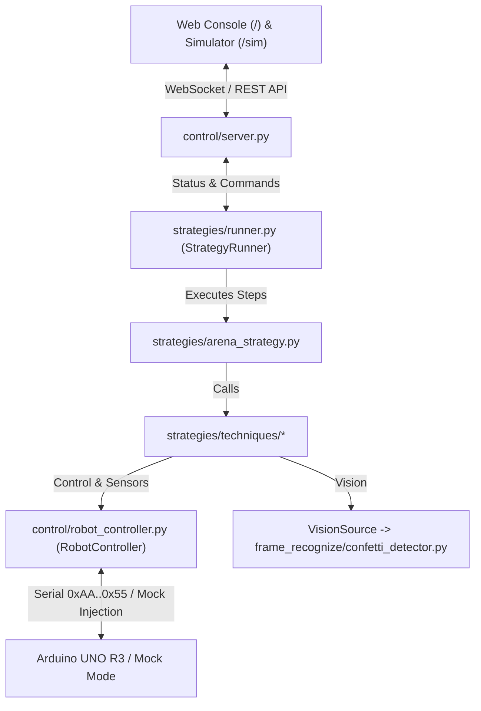

# Autonomous Strategy Module (`strategies/`) Architecture & Developer Guide

> Language: **English** | [繁體中文](README.zh.md)

This directory manages high-level **autonomous mission strategies**, **reusable motion/vision techniques**, and the **background execution runner (`StrategyRunner`)**, integrating cleanly with [RobotController](../control/robot_controller.py) and the Web debug console.

---

## 1. Directory Layout & Layered Architecture

```text
strategies/
├── __init__.py                 # Exports ARENA_STEPS, build_arena_strategy, StrategyRunner, registry helpers
├── README.md                   # English guide (this file)
├── README.zh.md                # Traditional Chinese guide
├── arena_strategy.md           # 16-step arena cleaning mission specification (formerly STRATEGY.md)
├── arena_strategy.py           # Main 16-step arena cleaning strategy implementation
├── registry.py                 # Auto-discovery and dynamic registration of strategies
├── runner.py                   # Background runner (multi-strategy, start-at-step, E-stop, step-debug)
└── techniques/                 # Reusable atomic motion/vision/vacuum building blocks
    ├── __init__.py
    ├── README.md               # Techniques specification & authoring guide (English)
    ├── README.zh.md            # Techniques specification & authoring guide (Chinese)
    ├── context.py              # StrategyContext (interruptible sleep, substate, safety guard)
    ├── navigation.py           # Heading turns, blind drive, front-distance stop, right-wall follow
    ├── vision_align.py         # RTSP/Mock frame capture & ConfettiDetector visual alignment
    └── vacuum_sweep.py         # Combined sinusoidal sweep + vacuum cleaning
```

### Layered Data Flow



---

## 2. Core Components

### 2.1 `arena_strategy.py` (Strategy Definition)
* Defines each mission phase via `StrategyStep(index, title, description, execute)`.
* Parameterizes speeds and distance thresholds inside `build_arena_strategy(...)` rather than hardcoding distances into titles or logic.
* Uses a shared `runtime_state` dict:
  * `ref_yaw`: Accumulated global reference heading (`[-180°, 180°)`). Turns apply relative deltas to `ref_yaw` instead of resetting the IMU at every corner, preventing cumulative drift and allowing clean execution starting from any step `1..N`.
  * `vision`: `VisionSource` handle passed to `on_tick` callbacks during cruising/wall-following to interrupt for confetti alignment & vacuuming.

### 2.2 `runner.py` (`StrategyRunner` Engine)
* **Non-blocking Execution**: Runs strategies on a background thread so FastAPI and WebSockets stay responsive.
* **Multi-Strategy Selection (`registry.py`)**: Dynamically discovers strategies via `discover_strategies()` and supports runtime switching via `select_strategy()` / `reload_strategies()`.
* **Start from Any Step**: Accepts `start_step` (`1..total_steps`) to test isolated segments directly.
* **Immediate Abort**: `stop()` sets `stop_event`, wakes any waiting step or pause barrier, stops sweep/vacuum relays, and brakes within `50 ms`.
* **Debug Step-by-Step Mode (`step_mode`)**:
  * Enable on `start(..., step_mode=True)` or toggle live via `set_step_mode(True)`.
  * Automatically stops motors and enters `PAUSED` between steps; call `step_next()` to run one step or `continue_run()` to resume continuous execution.
* **Safety Cleanup (`finally`)**: Always disables sweep, vacuum relay, and motors, stops `VisionSource`, and restores the original Arduino hardware E-Stop threshold.
* **Transparent Mock Mode**: Automatically binds `VisionSource` to `robot.get_injected_frame` when `robot.mock_mode` is active—zero `if mock:` branches needed in strategy code.

---

## 3. Creating a New Strategy

### Step 1: Create a New Strategy File (e.g., `strategies/custom_strategy.py`)
Each step function receives `(ctx: StrategyContext, st: Dict[str, Any]) -> bool` (`True` = completed, `False` = aborted):

```python
#!/usr/bin/env python3
# -*- coding: utf-8 -*-
from typing import Any, Dict, List

from .arena_strategy import StrategyStep
from .techniques import (
    StrategyContext,
    drive_until_front_distance,
    sweep_and_vacuum,
    turn_to_heading,
    wrap_angle_deg,
)


def build_my_strategy(speed: int = 120, stop_cm: float = 15.0) -> List[StrategyStep]:
    """Example rectangular patrol & spot-clean strategy"""

    def step_forward(ctx: StrategyContext, st: Dict[str, Any]) -> bool:
        res = drive_until_front_distance(
            ctx,
            heading_yaw=st["ref_yaw"],
            speed=speed,
            stop_front_cm=stop_cm,
        )
        return res != "STOPPED"

    def step_turn_right_90(ctx: StrategyContext, st: Dict[str, Any]) -> bool:
        st["ref_yaw"] = wrap_angle_deg(st["ref_yaw"] + 90.0)
        return turn_to_heading(ctx, st["ref_yaw"])

    def step_clean_spot(ctx: StrategyContext, st: Dict[str, Any]) -> bool:
        return sweep_and_vacuum(
            ctx,
            heading_yaw=st["ref_yaw"],
            speed=85,
            amp_deg=20.0,
            period_ms=1800,
            duration_sec=3.0,
        )

    return [
        StrategyStep(1, "Forward to Wall", "Drive straight until front stop distance", step_forward),
        StrategyStep(2, "Turn Right 90°", "Align in place to right heading (+90°)", step_turn_right_90),
        StrategyStep(3, "Spot Sweep & Vacuum", "Sweep and advance for 3s", step_clean_spot),
    ]


# Auto-discovered by strategies/registry.py for the Web UI dropdown
STRATEGY_ID = "custom_strategy"
STRATEGY_NAME = "Rectangular Patrol & Spot Clean"
STRATEGY_DESC = "3-step patrol, 90° turn, and spot vacuum demo"
build_strategy = build_my_strategy
```

### Step 2: Run Your Strategy

#### Option A: Via the Web Strategy Selector (Recommended)
Place the file under `strategies/` with the 4 module attributes above (`STRATEGY_ID`, `STRATEGY_NAME`, `STRATEGY_DESC`, `build_strategy`):
1. **No changes to [server.py](../control/server.py) or frontend HTML are required.**
2. Click **🔄** next to the strategy dropdown on `/` (or restart the server); [registry.py](registry.py) automatically discovers and populates the strategy and its steps.

#### Option B: Standalone Python Script
```python
import time
from control.robot_controller import RobotController
from strategies.runner import StrategyRunner
from strategies.custom_strategy import build_my_strategy

robot = RobotController(verbose=True)
robot.connect("/dev/ttyUSB0", 9600)

runner = StrategyRunner(robot, steps=build_my_strategy())
runner.start(start_step=1, enable_vision=False, reset_imu=True)

try:
    while runner.get_status()["status"] in ("RUNNING", "PAUSED"):
        time.sleep(0.2)
finally:
    runner.stop()
    robot.disconnect()
```

---

## 4. Recommended Testing Workflow
1. **Simulate in `/sim` & `/`**: Enable **Debug Mode (Step-by-Step)** in `/` while injecting ultrasonic/IMU/confetti frames in `/sim` to verify every transition and interruption handler.
2. **Real Hardware Segment Testing**: Use the **Start From Step** selector on real hardware to verify individual segments (e.g., jumping straight to Step 8 for right-wall following) before running the full 1–16 sequence.
