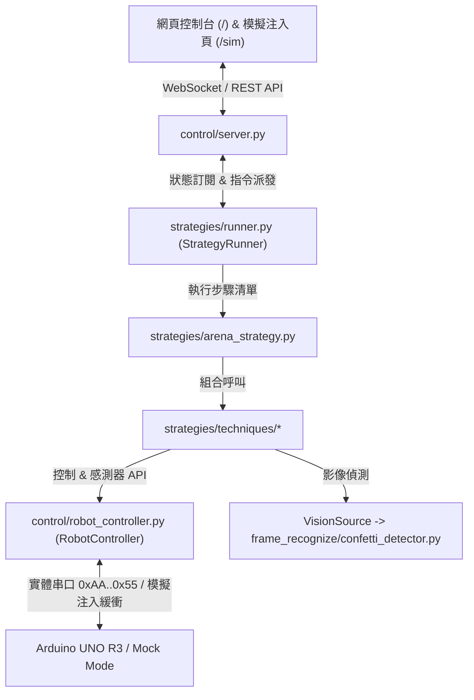

# 自動任務策略模組 (`strategies/`) 架構與開發指南

本目錄負責管理機器人的**高階自主任務流程（Strategy）**、**可重用組合技（Techniques）**與**背景執行引擎（StrategyRunner）**，並無縫串接底層車輛控制介面 [RobotController](file:///home/group6/mechatronics-4/control/robot_controller.py) 與網頁控制台。

---

## 1. 目錄結構與系統分層

```text
strategies/
├── __init__.py                 # 匯出 ARENA_STEPS, build_arena_strategy, StrategyRunner
├── README.zh.md                # 本文件：策略架構說明與新策略建立教學
├── arena_strategy.md           # 場地清掃策略規格書（原 STRATEGY.md）
├── arena_strategy.py           # 主策略實作（16 步驟場地清掃流程）
├── runner.py                   # 策略執行引擎（支援任意步驟啟動、即時停止、單步除錯與狀態推播）
└── techniques/                 # 底層可重用組合技函式庫
    ├── __init__.py
    ├── README.zh.md            # 各組合技原理說明與新組合技開發規範
    ├── context.py              # StrategyContext（可中斷休眠、子狀態回報、硬體防撞保護）
    ├── navigation.py           # 轉向、盲走直行、前方超音波停靠、沿右牆修正巡航
    ├── vision_align.py         # RTSP/模擬影格讀取與 ConfettiDetector 視覺對準
    └── vacuum_sweep.py         # 動態擺頭搭配吸塵馬達清掃
```

### 系統分層資料流



---

## 2. 核心元件職責說明

### 2.1 `arena_strategy.py`（策略定義層）
* 以資料結構 `StrategyStep(index, title, description, execute)` 明確定義每一個步驟。
* 透過工廠函式 `build_arena_strategy(...)` 將速度、牆距、停止距離等門檻參數化，避免寫死於邏輯內部。
* 內部維護共享狀態字典 `runtime_state`：
  * `ref_yaw`：全域基準航向角（度）。每次轉向只累加更新目標角度並正規化至 `[-180°, 180°)`，不反覆重設 IMU，避免轉彎誤差累積，同時讓策略能從任意第 N 步直接啟動。
  * `vision`：`VisionSource` 實例，供直行／沿牆步驟透過 `on_tick` 回呼進行行進間紙屑辨識插斷。

### 2.2 `runner.py`（策略執行引擎：`StrategyRunner`）
`StrategyRunner` 負責控制策略生命週期，與網頁後端共用同一個 `RobotController` 實例：
* **非阻塞執行**：呼叫 `start(...)` 後在背景執行緒執行，不卡住 FastAPI Event Loop 或終端機。
* **從任意步驟啟動**：支援指定 `start_step`（例如直接從第 8 步沿右牆開始測試）。
* **即時緊急停止**：呼叫 `stop()` 會立即設定 `stop_event`、喚醒任何等待中的步驟或單步暫停點，並在 `50ms` 內煞停車輛、關閉吸塵與擺頭。
* **單步除錯模式 (`step_mode`)**：
  * 啟動時傳入 `step_mode=True`（或執行中途透過 `set_step_mode(True)` 開啟），每完成一步即安全煞停進入 `PAUSED` 狀態。
  * 可呼叫 `step_next()` 執行下一步，或 `continue_run()` 恢復連續自動執行。
* **安全保證 (`finally`)**：無論策略正常結束、發生異常或中途被停止，皆保證關閉擺頭與吸塵繼電器、煞停車輛、停止影像擷取執行緒，並將 Arduino 硬體防撞門檻恢復為啟動前設定值（預設 `150 mm`）。
* **無縫支援模擬模式**：當 `robot.mock_mode == True` 時，`StrategyRunner` 自動將 `VisionSource` 的影格來源切換為 `robot.get_injected_frame`，使策略主程式在實體與 `/sim` 模擬環境下完全不用修改即可運行。

---

## 3. 如何創建一個新的 Strategy

你可以依照以下步驟建立自己的任務策略（例如測試巡檢、定點清掃等）：

### 步驟 1：建立新的策略檔案（例如 `strategies/custom_strategy.py`）

每個步驟函式固定接收 `(ctx: StrategyContext, st: Dict[str, Any]) -> bool`，回傳 `True` 代表步驟順利完成、`False` 代表中途收到停止訊號應立即中止策略。

```python
#!/usr/bin/env python3
# -*- coding: utf-8 -*-
from typing import Any, Dict, List

from .arena_strategy import StrategyStep
from .techniques import (
    StrategyContext,
    drive_until_front_distance,
    sweep_and_vacuum,
    turn_to_heading,
    wrap_angle_deg,
)


def build_my_strategy(speed: int = 120, stop_cm: float = 15.0) -> List[StrategyStep]:
    """自訂矩形巡邏與吸塵策略範例"""

    def step_forward(ctx: StrategyContext, st: Dict[str, Any]) -> bool:
        res = drive_until_front_distance(
            ctx,
            heading_yaw=st["ref_yaw"],
            speed=speed,
            stop_front_cm=stop_cm,
        )
        return res != "STOPPED"

    def step_turn_right_90(ctx: StrategyContext, st: Dict[str, Any]) -> bool:
        st["ref_yaw"] = wrap_angle_deg(st["ref_yaw"] + 90.0)
        return turn_to_heading(ctx, st["ref_yaw"])

    def step_clean_spot(ctx: StrategyContext, st: Dict[str, Any]) -> bool:
        return sweep_and_vacuum(
            ctx,
            heading_yaw=st["ref_yaw"],
            speed=85,
            amp_deg=20.0,
            period_ms=1800,
            duration_sec=3.0,
        )

    return [
        StrategyStep(1, "前進至牆邊", "直走直到前方到達安全停靠距離", step_forward),
        StrategyStep(2, "右轉 90 度", "原地旋轉對齊右側新航向 (+90°)", step_turn_right_90),
        StrategyStep(3, "定點擺頭清掃", "開啟吸塵與擺頭推進 3 秒", step_clean_spot),
    ]


# 供 strategies/registry.py 自動探索註冊，直接顯示於網頁「選擇策略」下拉選單
STRATEGY_ID = "custom_strategy"
STRATEGY_NAME = "矩形巡邏與定點吸塵策略"
STRATEGY_DESC = "3 步驟巡邏、轉向與定點擺頭吸塵示範"
build_strategy = build_my_strategy
```

### 步驟 2：執行你的新策略

#### 方式 A：直接掛載到網頁控制台「選擇策略」選單（推薦）
只要你的策略檔放在 `strategies/` 目錄下並定義上述 4 個模組變數（`STRATEGY_ID`, `STRATEGY_NAME`, `STRATEGY_DESC`, `build_strategy`）：
1. **完全不需修改 [server.py](file:///home/group6/mechatronics-4/control/server.py) 或網頁前端程式碼**。
2. 直接點擊網頁控制台策略選單旁的 **🔄** 按鈕（或重啟伺服器），[registry.py](file:///home/group6/mechatronics-4/strategies/registry.py) 便會自動掃描探索並將你的新策略加入下拉選單，可立即切換、選擇起始步驟與啟用單步除錯！

#### 方式 B：獨立 Python 腳本直接執行（無須網頁）
```python
import time
from control.robot_controller import RobotController
from strategies.runner import StrategyRunner
from strategies.custom_strategy import build_my_strategy

robot = RobotController(verbose=True)
robot.connect("/dev/ttyUSB0", 9600)

runner = StrategyRunner(robot, steps=build_my_strategy())
runner.start(start_step=1, enable_vision=False, reset_imu=True)

try:
    while runner.get_status()["status"] in ("RUNNING", "PAUSED"):
        time.sleep(0.2)
finally:
    runner.stop()
    robot.disconnect()
```

---

## 4. 建議測試與除錯流程
1. **開啟 `/sim` 模擬器與 `/` 主控制台**：先在模擬模式中勾選「**🐛 單步除錯 (Debug Mode)**」，測試每個步驟的轉向收斂、超音波邊界條件與紙屑對準反應。
2. **實車分段驗證**：利用主控制台「**起始步驟**」功能從特定步驟切入（例如直接從第 8 步開始測試沿右牆修正），確認個別階段穩定後再跑全程 1~16 步。
