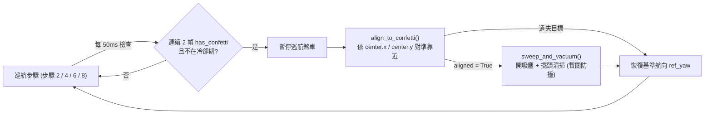

# 競賽場地自主清掃策略規格書 (`arena_strategy.md`)

本文件為 [arena_strategy.py](file:///home/group6/mechatronics-4/strategies/arena_strategy.py) 之戰術流程設計規格（由原 `STRATEGY.md` 整理擴充），描述機器人從進入場地、中央搜尋、沿牆巡邏、紙屑視覺吸取到離開出口的完整 16 步驟流程。

---

## 1. 策略設計原則與系統參數

### 1.1 座標與航向管理
* **IMU 航向定義**：右轉（順時針 CW）為 `+Yaw`，左轉（逆時針 CCW）為 `-Yaw`，範圍正規化於 `[-180°, +180°)`。
* **全域基準航向累計 (`ref_yaw`)**：策略於啟動時讀取當前航向作為初始基準，後續每次轉向直接對 `ref_yaw` 進行相對角度加減（`+90°` / `-90°` / `+180°`），不於轉角處重設 IMU，藉此避免累積轉彎偏差並支援從第 1~16 步中任意一步單獨切入測試。

### 1.2 參數化預設門檻 (`build_arena_strategy`)
距離與時間閾值皆集中於 `build_arena_strategy()` 統一設定，未寫死於步驟名稱或單一邏輯中：

| 參數名稱 | 預設值 | 說明 |
| :--- | :--- | :--- |
| `entry_speed` | `140` | 步驟 1 盲走進入場地前進速度 (PWM) |
| `entry_duration_sec` | `3.0` | 步驟 1 純 IMU 盲走持續秒數 |
| `cruise_speed` | `130` | 一般直線巡航速度 (PWM) |
| `wall_speed` | `120` | 沿右牆修正前行速度 (PWM) |
| `center_stop_cm` | `150.0` | 步驟 2 前方超音波停駐場地中間之停止距離 (cm) |
| `wall_dist_cm` | `15.0` | 沿右牆保持之目標右側牆距 (cm) |
| `stop_dist_cm` | `15.0` | 各直行／沿牆區段抵達對面邊界之前方停止距離 (cm) |
| `right_open_cm` | `100.0` | 步驟 14 判定右側出口開闊之右超音波閾值 (cm) |

### 1.3 安全與視覺插斷機制
* **進場與吸塵防撞保護**：步驟 1（盲走進入場地）與 `sweep_and_vacuum`（貼近吸塵）執行期間，透過 `temporarily_disable_safety()` 暫時關閉 Arduino 硬體急停（`0`），結束、異常或手動停止後自動恢復原門檻（預設 `150 mm`）。
* **行進間紙屑插斷 (`_make_confetti_tick`)**：步驟 2、4、6、8 在行進過程中持續監控影像（`VisionSource` 讀取 `/live/stream` 或 `/sim` 注入影格），當連續 2 幀偵測到紙屑且距離上次處理超過冷卻時間（`2.5s`）時，暫停巡航並執行：
  1. `align_to_confetti()`：依 `center.x` 與 `center.y` 進行視覺對準與逼近。
  2. `sweep_and_vacuum()`：開啟吸塵馬達與動態擺頭清掃（振幅 `±20°`、週期 `1800ms`、速度 `85`、上限 `4.0s`）。
  3. 完成後恢復原 `ref_yaw` 航向繼續走到該區段邊界。

---

## 2. 完整 16 步驟流程表

> 原 `STRATEGY.md` 第 1 點拆分為本規格的「步驟 1（純 IMU 進入）」與「步驟 2（巡航至中間）」，讓調試時可獨立測試進入段或直接從場地巡航開始。

| 步驟 | 名稱（網頁顯示） | 類型 / 組合技 | 目標航向變化 | 停止與結束條件 | 視覺紙屑插斷 |
| :---: | :--- | :--- | :--- | :--- | :---: |
| **1** | 盲走進入場地 | `drive_blind_imu` | 維持 `ref_yaw` | 純 IMU 直行 `entry_duration_sec`（忽略超音波，暫關防撞） | — |
| **2** | 前進至場地中間 | `drive_until_front_distance` | 維持 `ref_yaw` | 前方超音波 `<= center_stop_cm` | ✅ |
| **3** | 向右轉 90 度 (轉向 1) | `turn_to_heading` | `ref_yaw + 90°` | IMU 誤差收斂至 `±4°` 並穩定 | — |
| **4** | 向前直走至邊界 (區段 1) | `drive_until_front_distance` | 維持 `ref_yaw` | 前方超音波 `<= stop_dist_cm` | ✅ |
| **5** | 向右轉 90 度 (轉向 2) | `turn_to_heading` | `ref_yaw + 90°` | IMU 誤差收斂至 `±4°` 並穩定 | — |
| **6** | 向前直走至邊界 (區段 2) | `drive_until_front_distance` | 維持 `ref_yaw` | 前方超音波 `<= stop_dist_cm` | ✅ |
| **7** | 向右轉 180 度 (掉頭) | `turn_to_heading` | `ref_yaw + 180°` | 原地掉頭使右側朝向牆面 | — |
| **8** | 沿右牆直走至邊界 (區段 3) | `wall_follow_right` | 維持 `ref_yaw` ± 右牆修正 | 右牆貼牆保持 `wall_dist_cm` 至前方 `<= stop_dist_cm` | ✅ |
| **9** | 向左轉 90 度 (轉向 4) | `turn_to_heading` | `ref_yaw - 90°` | IMU 誤差收斂至 `±4°` 並穩定 | — |
| **10** | 沿右牆直走至邊界 (區段 4) | `wall_follow_right` | 維持 `ref_yaw` ± 右牆修正 | 右牆貼牆保持 `wall_dist_cm` 至前方 `<= stop_dist_cm` | — |
| **11** | 向左轉 90 度 (轉向 5) | `turn_to_heading` | `ref_yaw - 90°` | IMU 誤差收斂至 `±4°` 並穩定 | — |
| **12** | 沿右牆直走至邊界 (區段 5) | `wall_follow_right` | 維持 `ref_yaw` ± 右牆修正 | 右牆貼牆保持 `wall_dist_cm` 至前方 `<= stop_dist_cm` | — |
| **13** | 向左轉 90 度 (轉向 6) | `turn_to_heading` | `ref_yaw - 90°` | IMU 誤差收斂至 `±4°` 並穩定 | — |
| **14** | 沿右牆直走至右側開闊 | `wall_follow_right` | 維持 `ref_yaw` ± 右牆修正 | 右方超音波 `>= right_open_cm` 或連續無牆反射 (`-1`) 達 `0.6s` | — |
| **15** | 向右轉 90 度 (出口轉向) | `turn_to_heading` | `ref_yaw + 90°` | IMU 誤差收斂至 `±4°` 並穩定 | — |
| **16** | 向前走出出口 | `drive_until_front_distance` | 維持 `ref_yaw` | 最多直行 `5.0s` 或前方達 `<= stop_dist_cm` | — |

---

## 3. 行進間紙屑插斷流程圖

